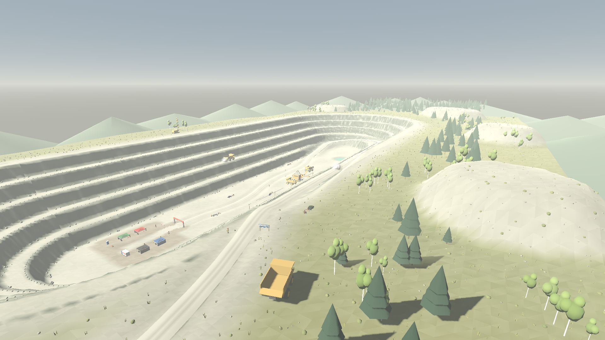
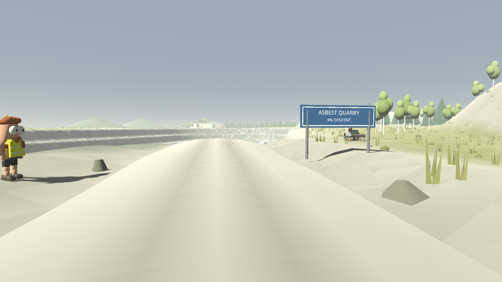
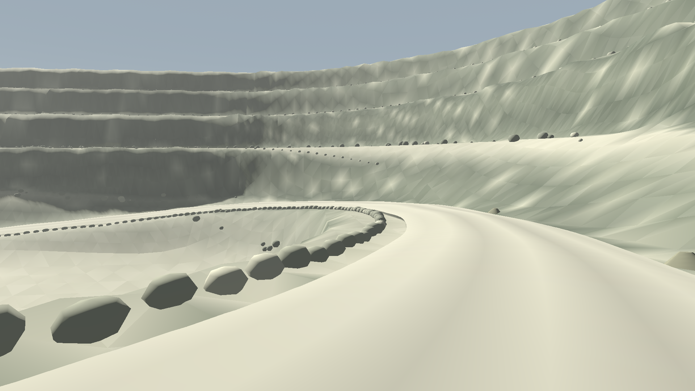
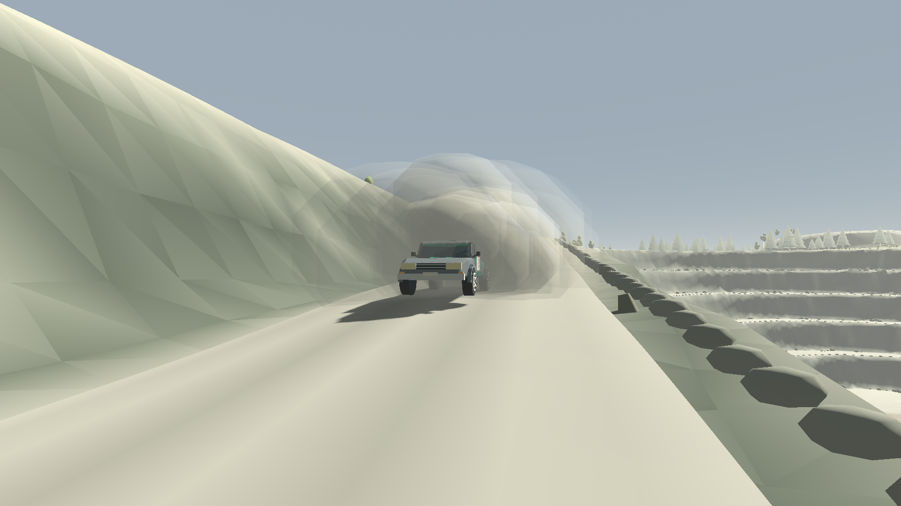
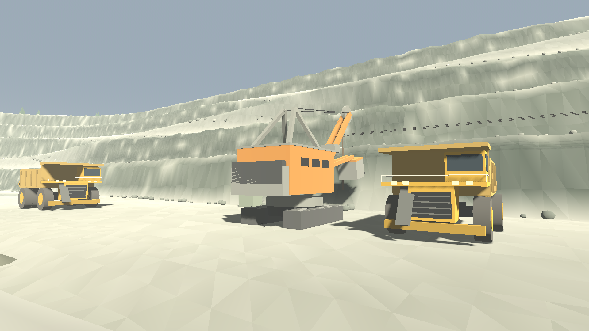
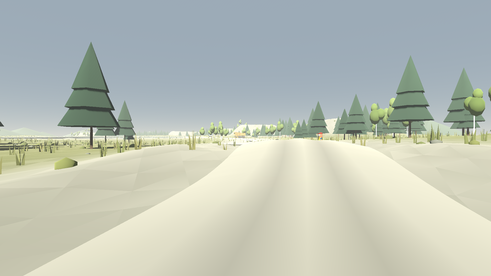

# Асбестовский карьер

Восьмой СУ, `content_id: 7`, товар `stage_08`. Построен по мотивам ралли в
Асбесте (Свердловская область): там спецучастки проложены по огромным
отвалам у карьера «Ураласбеста», крупнейшего в мире действующего карьера по
добыче хризотила (по открытым данным около 11 км в длину, до 2 км в ширину и
глубже 300 м). Журналисты называли эти СУ «лунным пейзажем почти без
ориентиров»; рядом в карьере работают 110–130-тонные БелАЗы, на фоне которых
раллийные машины кажутся игрушечными.



Карьер в игре уменьшен до размеров СУ, но сохраняет то, по чему его узнают:
вытянутая чаша с плоским дном, стены уступами, серпантин съезда по бортам и
белая пыль на всём, что лежит горизонтально.

| Станции | Участок |
| --- | --- |
| 0–375 | Отвалы к северу от карьера: быстрый гравий, два трамплина, берёзы на старых отвалах |
| 375–948 | Съезд: заход с восточного борта, спуск вдоль него, разворот у южного торца, спуск по западному борту на дно |
| 948–1188 | Дно карьера: мимо экскаватора с БелАЗами к финишу и парку сервиса |

Длина 1188 м, уклон съезда 9 % (как на настоящих карьерных дорогах), перепад
50 м.

## Как устроен СУ

Как и Чарын, СУ разделён на землю и дорогу. `quarry_form.gd` описывает
карьер в мировых координатах и ничего не знает о дороге: дно — «стадион»
вокруг оси, пять уступов по 10 м, каждый из крутого откоса (5,5 м по
горизонтали) и ровной бермы. Все уступы идут на одном расстоянии от оси,
поэтому бермы сохраняют ширину и на закруглениях торцов. Вокруг карьера —
поле с отвалами: столовые горы с плоским верхом и склонами под углом
естественного откоса.

`quarry_route.gd` прокладывает дорогу по этой земле. Съезд не нарисован на
глаз: каждый метр дорога опускается на 9 % и держится там, где стена,
прочитанная как ровный склон через середины берм, достигает этой высоты
(`Form.slope_reach`). Поэтому выемка и насыпь остаются мелкими. Сплайн и
пересчёт в станции по длине дуги общие с каньоном (`canyon_route.spline`,
`resample`). Длина СУ кратна 4 м: общий код читает дорогу шагами `STEP`.



Съезд шире дороги по отвалам (9 м против 7,4), на нём нет обочины для
зрителей. По открытому краю идёт **предохранительный вал** из глыб
(`HaulWindrow`): он останавливает машину и не даёт сорваться на берму ниже.
Откосы уступов непролазны: ходок упирается в них (`walk_blocked`), машина не
заезжает (`drive_blocked`, как в каньоне).



## Белая пыль

Всё ровное — бермы, дно, дорога, отвалы — покрыто светлой пылью
серпентинита, откосы показывают тёмную зелёно-серую породу с белыми жилками
хризотила. Там, где дорога врезана в откос, видна порода; ниже насыпь из
серой осыпи.



За каждой машиной в движении — экипажи, полиция, скорая, машины игроков —
тянется белое облако, которое висит несколько секунд (`quarry_life.gd`).
Облаков шесть, их получают ближайшие к игроку машины быстрее 4 м/с. Пыль
локальная: каждый клиент рисует её сам по положениям машин, по сети ничего не
передаётся. Небо и туман в `stages.json` светлые, над карьером — бледная
дымка.

## Техника



`quarry_machines.gd` строит технику в натуральную величину из примитивов:

| Машина | Где | Что умеет |
| --- | --- | --- |
| БелАЗ 130 т (класс 75131) | грузится у экскаватора, ждёт очереди на дне, стоит у зрителей на борту | кабина слева на верхней площадке, двойные задние колёса, кузов с козырьком, груз породы |
| Экскаватор ЭКГ | дно, у восточного откоса | поворотная платформа, стрела, рукоять и ковш; цикл копание — поворот к БелАЗу — разгрузка с облаком пыли |
| БелАЗ на берме | вторая берма западного борта | ездит туда-обратно и пылит |
| Буровой станок СБШ | западный борт | мачта 17 м |

Экскаватор питается по кабелю: линия опор у подножия откоса, трансформаторная
подстанция и кабель по дну. В зумпфе на дне стоит зелёная карьерная вода. За
отвалами на северо-востоке — корпуса и трубы фабрики, вокруг — низкие
лесистые хребты Среднего Урала.

Вся стоящая техника твёрдая (`stage.solids` и круги `stage.rocks`), вплотную
к дороге ничего не стоит.



## Зрители

Шесть зрительских площадок: у старта и на трамплинах отвалов, на борту над
началом съезда, три на дне под стенами, откуда видно, как экипажи спускаются
по бортам. Под каждой ровная площадка, лагерь стоит на ней. На съезде
одиночных зрителей нет (`roadside_spectators()`).

## Файлы

| Файл | Что в нём |
| --- | --- |
| `quarry_form.gd` | Ось, дно, уступы, бермы, отвалы и зумпф в мировых координатах |
| `quarry_route.gd` | Контрольные точки, съезд с постоянным уклоном, трамплины, профиль высот |
| `quarry.gd` | Биом: рельеф с врезанной дорогой, цвета породы и пыли, покрытие, скорости |
| `quarry_scenery.gd` | Вал вдоль съезда, бермы, осыпь, техника, ЛЭП, зумпф, берёзы, табличка, горизонт |
| `quarry_machines.gd` | БелАЗ, экскаватор ЭКГ, буровой станок |
| `quarry_life.gd` | Пыль за машинами, работа экскаватора, БелАЗ на берме |

## Проверка

`game/tests/stages/test_quarry.gd` (шард `world`) проверяет маршрут (длину,
уклон и глубину съезда, дорогу внутри карьера, финиш на дне, разворот),
уступы, непролазность откосов, цвета породы и пыли, вал вдоль открытого края,
технику и её коллизии, зрителей, пыль за машиной и её отсутствие у стоящей,
работу экскаватора и БелАЗа на берме, совпадение видимой дороги с
поверхностью контакта и одинаковый карьер у всех участников комнаты.

Локальные проверки (не в CI):

```sh
godot --headless --path game --script res://tools/profile/service_route.gd -- --stage=7 --watchdog=1400
godot --headless --path game --script res://tools/profile/find_camp_ground.gd -- --stage=7
xvfb-run -a godot --path game --rendering-method gl_compatibility --script res://tools/profile/find_passable.gd -- --stage=7
```

На 2026-10-22: полиция и скорая проходят СУ в обе стороны, мимо машин на
обочине и машины поперёк самого узкого места (8/8); 30 предметов лагерей
стоят на земле; проходимых декораций и невидимых стен нет.

Снимки и картинки меню:

```sh
xvfb-run -a godot --path game --rendering-method gl_compatibility \
  --audio-driver Dummy --script res://tools/screenshots/export_quarry_screenshots.gd
```
