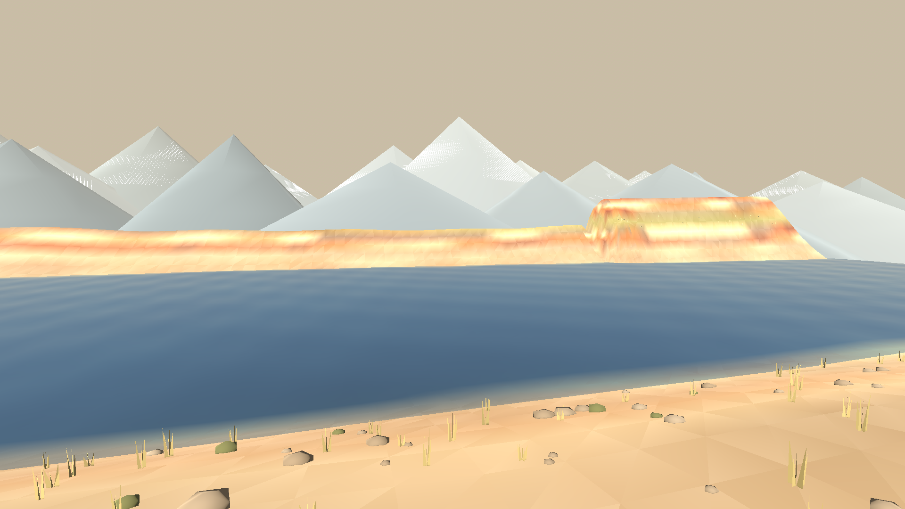
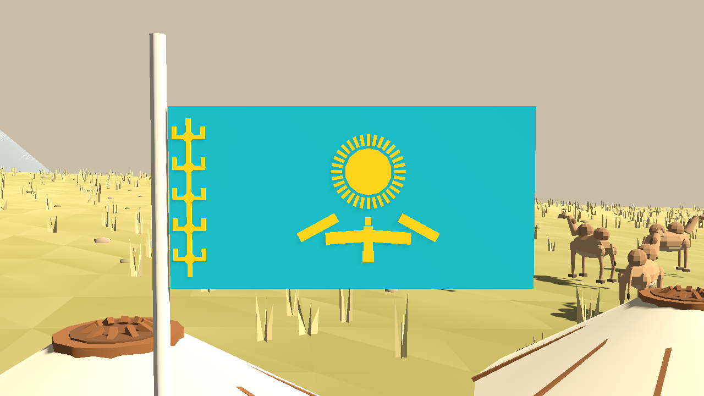

# Чарынский каньон

Четвёртый СУ, `content_id: 3`, построен по мотивам национального парка
Чарынский каньон в Казахстане. Длина общая для всех трасс — 840 маршрутных
единиц; фактическое расстояние больше на поворотах и спусках.


Маршрут идёт **вдоль каньона сверху**, разворачивается **шпилькой** у головы
ущелья, спускается **полкой, врезанной в стену**, и выходит **по дну к
ясеневой роще** над рекой Или, где стоит парк сервиса.

| Станции | Участок |
| --- | --- |
| 0–176 | Кромка: ковыльная степь, обрыв слева, юрты и верблюды |
| 176–254 | Шпилька у головы ущелья и выход за кромку |
| 254–560 | Полка по стене: спуск около 36 м вместе с рекой |
| 560–840 | Галечное дно, ясеневая роща, финиш и парк сервиса |

## Как устроен СУ

Земля задана **в мировых координатах** и ничего не знает о дороге:
`canyon_form.gd` описывает ось реки, её меандр, профиль дна, глубину и
стены. `canyon_route.gd` прокладывает по этой земле дорогу, а `canyon.gd`
связывает их. Поэтому каньон существует сам по себе — дорога идёт сначала
над ним, потом внутри него, и оба раза это одно и то же ущелье.

Маршрут **разворачивается на себя**, поэтому СУ использует `winding_route()`:
станция ищется по индексу маршрута, а не читается из `-z`.

## Стены

Плато поднимается к Долине замков, где река пропилила его глубже всего
(около 50 м), и обрушивается к долине Или у устья. Дно падает вниз по
течению всю дорогу.


Стена не склон: она встаёт **тремя почти отвесными обрывами**, между которыми
остаются узкие полки осыпи (`wall_profile`). Вылет стены и её подножие
меняются вдоль ущелья (`wall_run`, `wall_foot`), так что в стену врезаны ниши
и из неё выступают контрфорсы; головы боковых промоин выедают кромку, а
уцелевшие останцы стоят на ней зубцами (`crest`).

Дно — щель шириной около 30 м у замков и широкая галечная пойма (до 160 м) у
рощи. Горизонтальная слоистость стен — красный песчаник, серые галечники и
светлый мергель — задана по высоте, поэтому стена и вырезанные из неё замки
окрашены одним и тем же законом. На лицах стен треугольники рельефа — 1 м.

Стены непролазны: ходок упирается в осыпь у подножия, подняться из ущелья
пешком нельзя.

## Кромка и шпилька


На старте дорога отходит от обрыва — там нужен ровный грунт под парк
сервиса, — а дальше выходит почти на саму кромку. Слева степь с юртами и
верблюдами, справа обрыв.


У головы ущелья дорога разворачивается полукругом радиусом около 13 м и
уходит за кромку вниз. Расчётная скорость экипажей в развороте — 11 м/с.

## Полка


Полка не нарисована на глаз: на каждом шаге вниз построитель спрашивает у
стены, где она стоит на той высоте, которой достигла дорога
(`canyon_route.wall_lateral`), поэтому дорога идёт по склону и выемка
остаётся мелкой. Уклон нигде не круче 11%. По краю обрыва через каждые 11 м
стоят побелённые каменные столбики.

Зрительских полян на полке нет — там негде стоять. Они стоят на степи, на
кромке над спуском и внизу, на галечных отмелях; `blend_clearings` ровняет
под ними землю.

## Роща и парк сервиса


Внизу по течению каньон мелеет, днище расширяется, и перед выходом реки в
долину Или стоит роща реликтового согдийского ясеня: деревья далеко друг от
друга, подлеска нет, между ними мягкая трава. Это единственные деревья СУ.
Финиш и **парк сервиса** стоят в роще на ровной галечной пойме.

## Река Или



За рощей и парком сервиса каньон кончается: стены расходятся, дно
выполаживается, и поперёк карты, от края до края, течёт Или — река глубиной
около трёх метров. Дальний берег поднимается, за ним стоят предгорья и
снеговые вершины Тянь-Шаня.

Вода — общий механизм игры, а не особенность одного СУ: `water.gd` больше не
знает про «Финский лес», он спрашивает биом, где стоит вода
(`water_level`) и какие полотна рисовать (`water_bodies`). Полотно задаётся
либо коробкой вдоль трассы, как озёра, либо мировой коробкой, как река
поперёк карты. Отсюда работают плавучесть, брод, заплыв и брызги.

## Степь


На плато — ковыль, полынь и выгоревшие камни, стоянка из трёх юрт с очагом,
коновязью и флагом; вторая, поменьше, — внизу в роще. Юрта собрана из
войлочной стены, купола, шанырака и крашеной деревянной двери.



Флаг собран по настоящему: голубое полотнище, солнце с 32 лучами по центру,
под ним степной орёл с распахнутыми крыльями и вертикальная полоса
орнамента «кошкар-муйз» у древка.


По степи пасутся четыре стада двугорбых верблюдов: модель `camel_model.gd`
держит четыре позы — стойка, пастьба и две половины шага. Верблюды не
пугливы: человека они замечают с 17 м, поднимают голову и неторопливо
отходят. Над ущельем кругами ходят степные орлы, от очага стоянки
поднимается дым, за игроком тянется пыль.

## Файлы

| Файл | Что в нём |
| --- | --- |
| `canyon_form.gd` | Ось, дно, глубина, ширина и стены ущелья в мировых координатах |
| `canyon_route.gd` | Контрольные точки дороги, шпилька, поиск полки, профиль высот |
| `canyon.gd` | Биом: рельеф с врезанной дорогой, цвета, покрытие, скорости |
| `canyon_scenery.gd` | Замки, осыпи, степь, дно, роща, юрты, столбики |
| `stages/water.gd` | Общая вода игры: озёра «Финского леса» и Или под каньоном |
| `canyon_life.gd`, `camel_model.gd` | Верблюды, орлы, дым и пыль |
| `yurt.gd` | Юрта и лагерь вокруг неё |

## Нагрузка на кадр

Рельеф разбит на тайлы по 64 м, а дорога — на отрезки по 64 м, поэтому
пирамида видимости выбрасывает всё, что скрыто стеной за спиной камеры:
раньше и то и другое рисовалось целиком каждый кадр и ещё раз в каждом
каскаде тени. Скалы Долины замков тоже собраны не одним мешом, а кусками по
участкам ущелья. Мелкие треугольники (1 м) остаются только на лицах стен,
где есть что показывать; остальное — 2 м у дороги и 4 м на ровном.

## Проверка

`game/tests/stages/test_canyon.gd` проверяет маршрут (кромка вверх по
течению, разворот, уклоны, посадку дороги на рельеф), ущелье (глубину,
узость у замков, полосатый профиль стен, непролазность, полку спуска), рощу
и парк сервиса в ней, реку Или за ним, поляны и ровную землю под
зрителями, верблюдов и орлов, совпадение клиентов и совпадение видимой
дороги с поверхностью контакта. Тест входит в `npm test`.
Серверная проверка комнат — в `tests/room-core.test.mjs`.

Снимки и картинки меню снимаются заново:

```sh
xvfb-run -a godot --path game --rendering-method gl_compatibility \
  --audio-driver Dummy --script res://tools/screenshots/export_canyon_screenshots.gd
```
