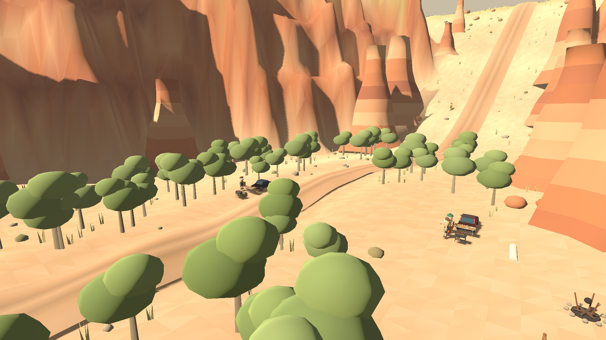

# Чарынский каньон

Четвёртый СУ, `content_id: 3`, построен по мотивам национального парка
Чарынский каньон в Казахстане: ровная ковыльная степь, в которую врезано
ущелье Долины замков, и река, прорезавшая слоистые стены. Длина общая для
всех трасс — 840 маршрутных единиц; фактическое расстояние больше на
поворотах и спусках.


| Станции | Геометрия |
| --- | --- |
| 0–170 | Степное плато: длинные дуги, ковыль, юрточная стоянка и верблюды |
| 170–220 | Кромка каньона и скальные ворота |
| 220–410 | Спуск по полке, вырубленной в стене: обрыв около 58 м |
| 410–560 | Дно ущелья, узкий коридор между стенами |
| 560–680 | Сухое русло, ясеневая роща, рыхлый грунт |
| 680–840 | Выход обратно на степь |

`game/scripts/stages/canyon/canyon.gd` задаёт маршрут, грунт и стены;
`canyon_scenery.gd` — скалы, растительность и стоянки; `canyon_life.gd` и
`camel_model.gd` — живность; `yurt.gd` — юрты и лагерь вокруг них.

## Стены

Плато лежит на отметке 64 м, дно реки — примерно на 58 м ниже. Стена
поднимается от подножия до кромки не одним откосом, а тремя обрывами, между
которыми остаются узкие полки осыпи (`wall_profile`). Подножие и вылет стены
меняются вдоль ущелья (`wall_foot`, `wall_run`), поэтому в неё врезаны ниши и
выступают контрфорсы. Головы боковых промоин выедают кромку, а уцелевшие
останцы стоят на ней зубцами (`crest`, `rim_towers`).


Дно узкое: половина ширины около 23 м, с двумя амфитеатрами на 462 и 616
станциях и двумя боковыми промоинами. На полках стен стоят отдельные
столбы-останцы, у подножия лежат глыбы осыпи с настоящими коллизиями.
Треугольники рельефа на дороге и по лицу стен — 2 м вместо 4 м.

Стены непролазны: ходок останавливается на осыпи у подножия, подняться из
ущелья пешком нельзя. Лазаемых террасных останцев на этом СУ больше нет —
зрительские поляны расположены на земле: две в степи, три на дне и одна за
выездом.

## Спуск


На спуске дорога идёт полкой: стена выше по склону, обрыв ниже. Ширина
полотна уменьшается, расчётная скорость экипажей падает до 15 м/с, а по краю
обрыва через каждые 11 м стоят побелённые каменные столбики.

## Степь и айдентика


На плато — ковыль, полынь и выгоревшие камни, стоянка из трёх юрт с очагом,
коновязью и флагом, вторая, поменьше, — внизу у русла. Юрта собрана из
войлочной стены, купола, шанырака и крашеной деревянной двери.


По степи пасутся четыре стада двугорбых верблюдов: модель
`camel_model.gd` держит четыре позы — стойка, пастьба и две половины шага.
Верблюды не пугливы: подходящего человека они замечают с 17 м, поднимают
голову и неторопливо отходят. Над ущельем кругами ходят степные орлы, от
очага стоянки поднимается дым, за игроком тянется пыль.



В русле растёт ясеневая роща — единственные деревья СУ, с коллизиями, как
на других трассах. Лесных ягод и грибов здесь нет.

## Проверка

`game/tests/stages/test_canyon.gd` проверяет глубину и узость ущелья,
полосатый профиль стен и их непролазность, полку спуска, ровность полян,
рощу в русле, башни, юрты, верблюдов и орлов, совпадение клиентов и то, что
видимая дорога совпадает с поверхностью контакта. Тест входит в `npm test`.
Серверная проверка комнат — в `tests/room-core.test.mjs`.

Снимки и картинки меню снимаются заново:

```sh
xvfb-run -a godot --path game --rendering-method gl_compatibility \
  --audio-driver Dummy --script res://tools/screenshots/export_canyon_screenshots.gd
```
