# Чарынский каньон

Четвёртый СУ, `content_id: 3`, построен по мотивам национального парка
Чарынский каньон в Казахстане. Это самый длинный СУ в игре: **2040 м**
(`route_length()`), почти в два с половиной раза длиннее остальных (840 м).
Земля под него тоже больше: 408 × 1500 м вместо 408 × 1000 (`world_bounds()`).

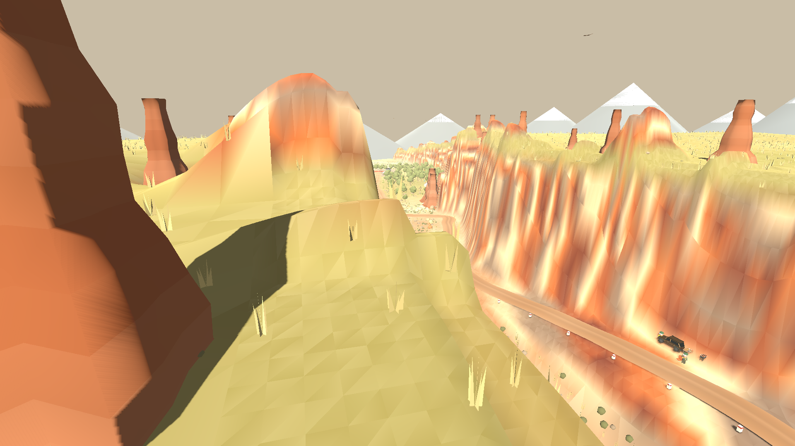

Маршрут идёт **по плато вверх по ущелью**, разворачивается **шпилькой** у
головы каньона, спускается **полкой, врезанной в стену прямо под дорогой
плато**, и выходит **по сухому дну Долины замков** между замками к **ясеневой
роще** над Или, где стоит парк сервиса. Трасса проходит каньон дважды: сверху
и снизу.

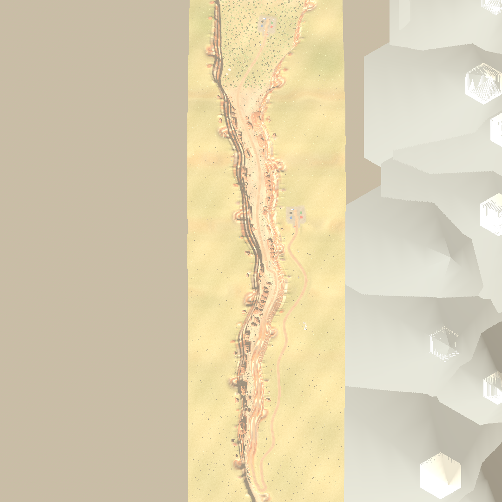

| Станции | Участок |
| --- | --- |
| 0–720 | Плато: старт над дном каньона, дальше вдоль кромки над полкой, юрты и верблюды |
| 720–800 | Шпилька у головы ущелья и выход за кромку |
| 800–1380 | Полка по стене под дорогой плато: спуск около 46 м вместе с рекой |
| 1380–1860 | Сухое дно Долины замков: дорога петляет между замками |
| 1860–2040 | Галечная пойма, ясеневая роща, финиш и парк сервиса |

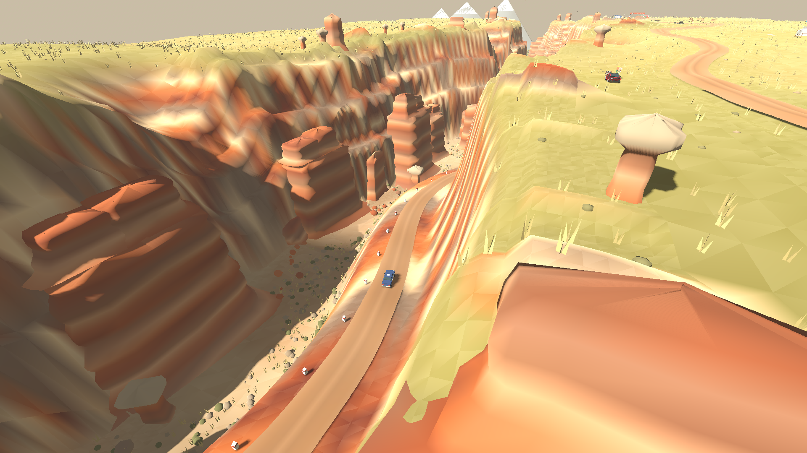

## Как устроен СУ

Земля задана **в мировых координатах** и ничего не знает о дороге:
`canyon_form.gd` описывает ось реки, её меандр, профиль дна, глубину и
стены. `canyon_route.gd` прокладывает по этой земле дорогу, а `canyon.gd`
связывает их. Поэтому каньон существует сам по себе — дорога идёт сначала
над ним, потом внутри него, и оба раза это одно и то же ущелье.

Маршрут **разворачивается на себя**, поэтому СУ использует `winding_route()`:
станция ищется по индексу маршрута, а не читается из `-z`.

## Стены

Плато поднимается к Долине замков, где река пропилила его глубже всего
(около 70 м почти на километр), и обрушивается к долине Или у устья. Дно
(`BEDS`) падает вниз по течению всю дорогу.

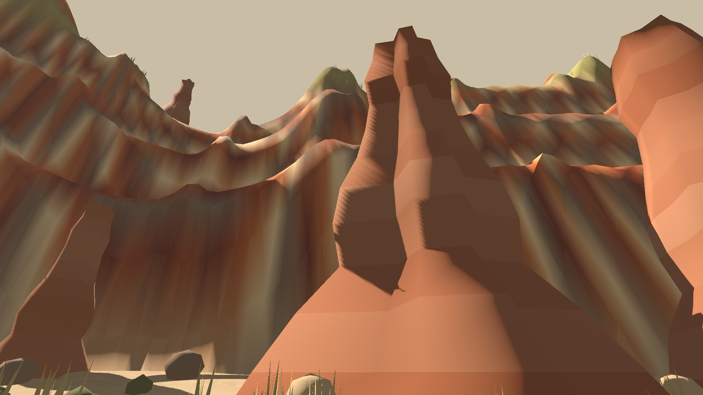

Стена не склон: она встаёт **тремя почти отвесными обрывами**, между которыми
остаются узкие полки осыпи (`wall_profile`). Вылет стены и её подножие
меняются вдоль ущелья (`wall_run`, `wall_foot`), так что в стену врезаны ниши
и из неё выступают контрфорсы; головы боковых промоин выедают кромку, а
уцелевшие останцы стоят на ней зубцами (`crest`).

Дно — сухая щель шириной 20–50 м через всю Долину замков и широкая
галечная пойма (до 180 м) у рощи. Горизонтальная слоистость стен — красный песчаник, серые галечники и
светлый мергель — задана по высоте, поэтому стена и вырезанные из неё замки
окрашены одним и тем же законом. На лицах стен треугольники рельефа — 1 м.

Стены непролазны: ходок упирается в осыпь у подножия, подняться из ущелья
пешком нельзя. Машина тоже: `drive_blocked()` останавливает её, когда земля
впереди поднимается круче 0,85 м на метр, так что по стене каньона не
заехать. Прогноз движения в сети спрашивает тот же хук.

## Замки

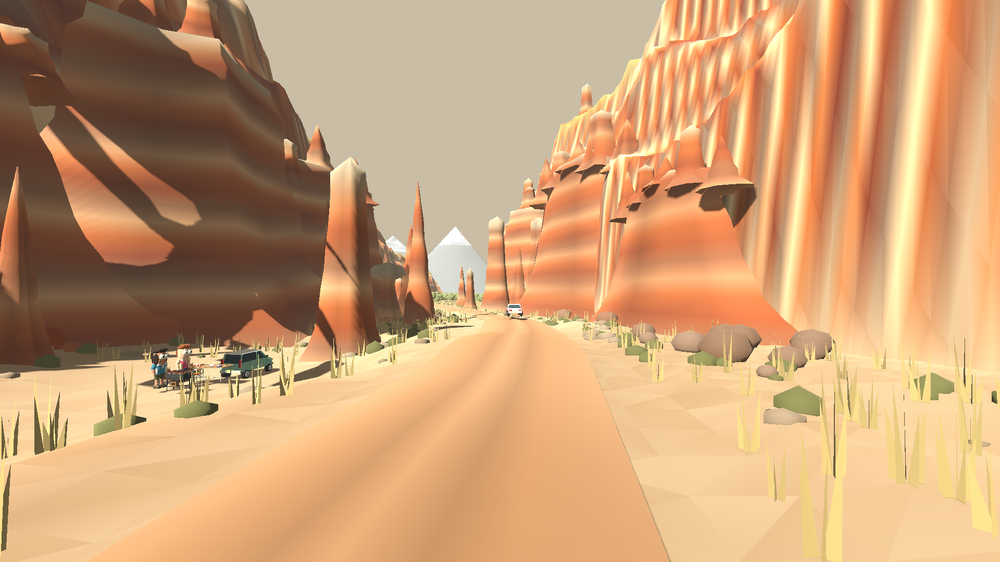

`canyon_castles.gd` строит шесть форм по фотографиям Долины замков, где
красный глинистый песчаник стоит массивными блоками с плоским верхом,
рассечёнными вертикальными трещинами на башни разной высоты:

| Форма | Где стоит | Какая |
| --- | --- | --- |
| замок | у подножия стены, на дне, на полках | ряд блочных башен разной высоты с щелями между ними |
| бастион | у подножия стены | массивный ступенчатый блок, на нём блоки поменьше |
| блок | на дне, на полках | одиночная башня с плоским верхом |
| ребро | у подножия, на полках | длинная узкая стена с изломанным гребнем |
| плита | на дне, на полках | отколовшийся слоистый блок, лежит с наклоном |
| гриб | на дне, редко | приземистая шея под плоской серой шляпой |

Форма — кольца сечения (скруглённый прямоугольник с трещинами) по профилю
(осыпь у основания, лёгкое сужение, уступы слоёв, каждый третий слой выветрен
бороздой); цвет — те же слои, что у стен, с частой горизонтальной
полосатостью. Замки, бастионы и рёбра вытянуты вдоль стены и наполовину
утоплены в неё. Плато над каньоном голое, как в жизни.

## Кромка и шпилька

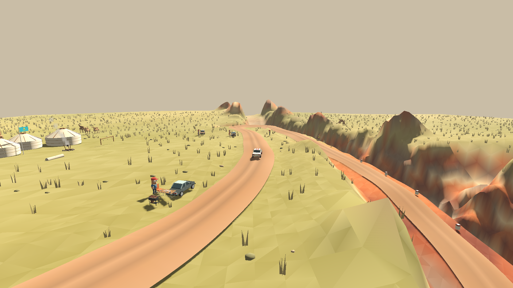

На старте дорога отходит от обрыва — там нужен ровный грунт под парк
сервиса, — а дальше выходит почти на саму кромку. Слева степь с юртами и
верблюдами, справа обрыв.

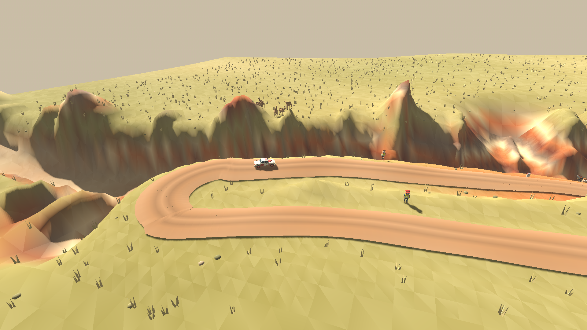

Старт — на плато над дном каньона: дорога сразу выходит к обрыву, и внизу
видна та часть трассы, которой экипажи поедут в конце. Дальше она отходит от
кромки на 30–40 м, потому что под ней по стене идёт полка, а у головы ущелья
снова выходит на край.

У головы ущелья дорога разворачивается полукругом радиусом около 13 м и
уходит за кромку вниз. Расчётная скорость экипажей в развороте — 11 м/с.

## Полка

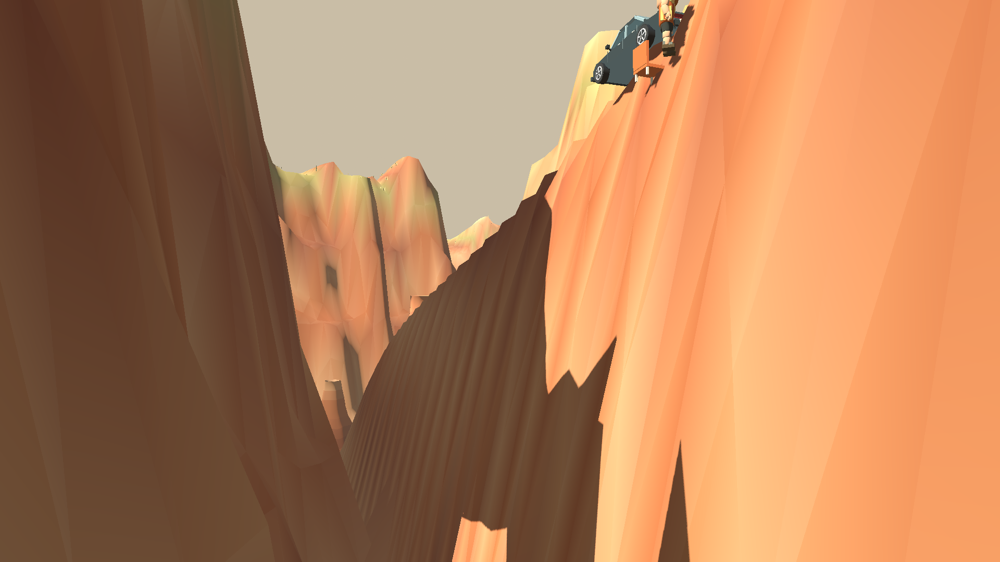

Полка не нарисована на глаз: на каждом шаге вниз построитель спрашивает у
стены, где она стоит на той высоте, которой достигла дорога
(`canyon_route.wall_lateral`), поэтому дорога идёт по склону и выемка
остаётся мелкой. Уклон нигде не круче 12%. По краю обрыва через каждые 11 м
стоят побелённые каменные столбики.

## Зрители

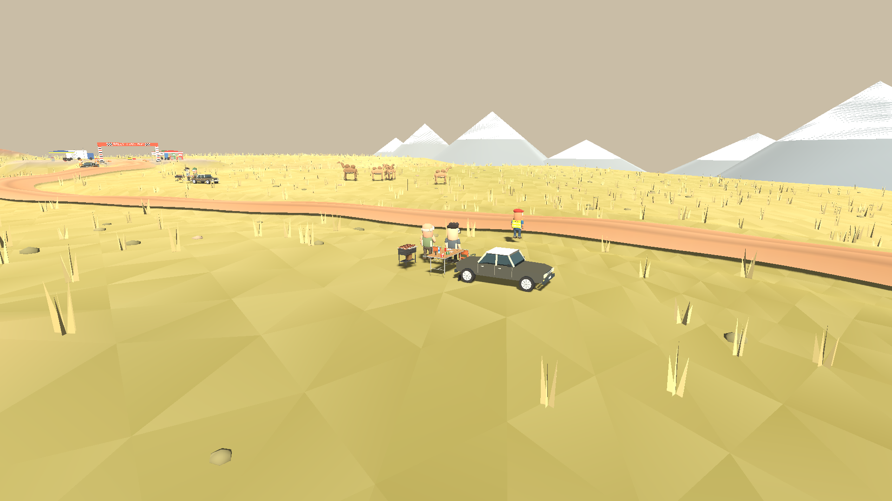

Зрительских полян на полке и вдоль узкого дна нет — там негде стоять, и
одиночных зрителей у обочины на этом СУ тоже нет (`roadside_spectators()`).
Десять полян стоят так, как стоят на настоящем ралли: у старта на степи,
три на самой кромке каньона над дорогой внизу, на степи над шпилькой, на
дне под полкой, откуда видно, как экипажи спускаются по стене, две в
Долине замков и две в роще. Под каждой поляной ровная площадка радиусом
6,5 м, выровненная поверх насыпи дороги, и весь лагерь (машина, стол, мангал,
люди) стоит на ней, а не на склоне вокруг.

## Роща и парк сервиса

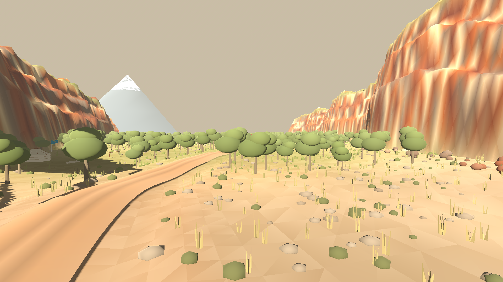

Внизу по течению каньон мелеет, днище расширяется, и перед выходом реки в
долину Или стоит роща реликтового согдийского ясеня: деревья далеко друг от
друга, подлеска нет, между ними мягкая трава. Это единственные деревья СУ.
Финиш и **парк сервиса** стоят в роще на ровной галечной пойме.

## Степь

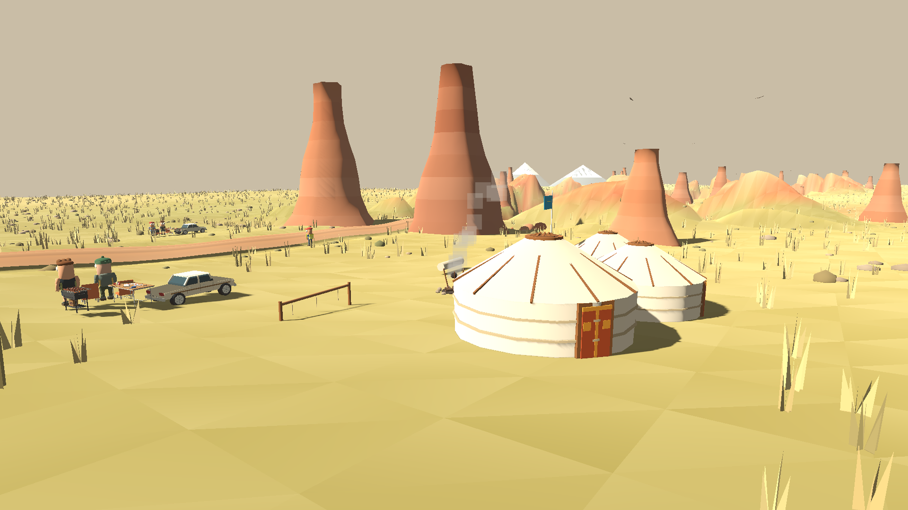

На плато — ковыль, полынь и выгоревшие камни, стоянка из трёх юрт с очагом,
коновязью и флагом; вторая, поменьше, — внизу в роще. Юрта собрана из
войлочной стены, купола, шанырака и крашеной деревянной двери.

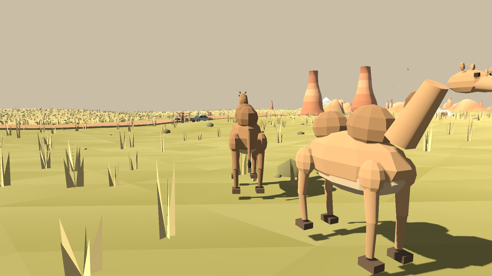

По степи пасутся четыре стада двугорбых верблюдов: модель `camel_model.gd`
держит четыре позы — стойка, пастьба и две половины шага. Верблюды не
пугливы: человека они замечают с 17 м, поднимают голову и неторопливо
отходят. Над ущельем кругами ходят степные орлы, от очага стоянки
поднимается дым, за игроком тянется пыль.

## Файлы

| Файл | Что в нём |
| --- | --- |
| `canyon_form.gd` | Ось, дно, глубина, ширина и стены ущелья в мировых координатах |
| `canyon_route.gd` | Контрольные точки дороги, шпилька, поиск полки, профиль высот |
| `canyon.gd` | Биом: рельеф с врезанной дорогой, цвета, покрытие, скорости |
| `canyon_scenery.gd` | Расстановка замков, осыпи, степь, дно, роща, юрты, столбики |
| `canyon_castles.gd` | Шесть форм замков: бастион, ребро, башня, гриб, игла, купол |
| `canyon_life.gd`, `camel_model.gd` | Верблюды, орлы, дым и пыль |
| `yurt.gd` | Юрта и лагерь вокруг неё |

## Проверка

`game/tests/stages/test_canyon.gd` проверяет маршрут (длину больше двух
километров, кромку вверх по течению, разворот, дорогу плато над полкой,
уклоны, посадку дороги на рельеф), ущелье (глубину, узость у замков,
полосатый профиль стен, непролазность для ходока и машины, полку спуска,
все шесть форм замков), рощу и парк сервиса в ней, поляны и то, что каждый
зритель стоит на ровном месте вне дороги, верблюдов и орлов, совпадение
клиентов и совпадение видимой дороги с поверхностью контакта. Тест входит в `npm test`.
Серверная проверка комнат — в `tests/room-core.test.mjs`.

Снимки и картинки меню снимаются заново:

```sh
xvfb-run -a godot --path game --rendering-method gl_compatibility \
  --audio-driver Dummy --script res://tools/screenshots/export_canyon_screenshots.gd
```
