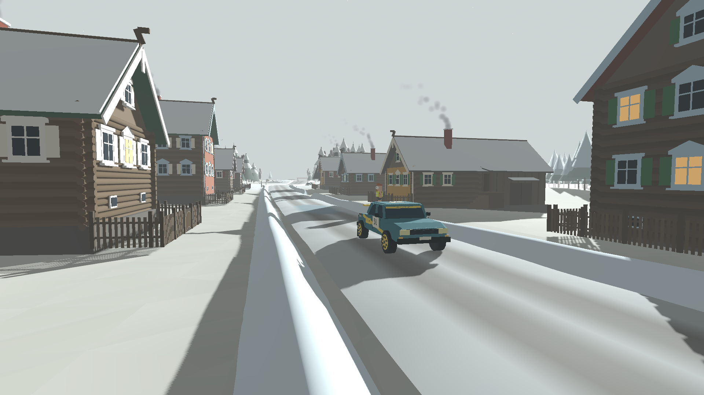
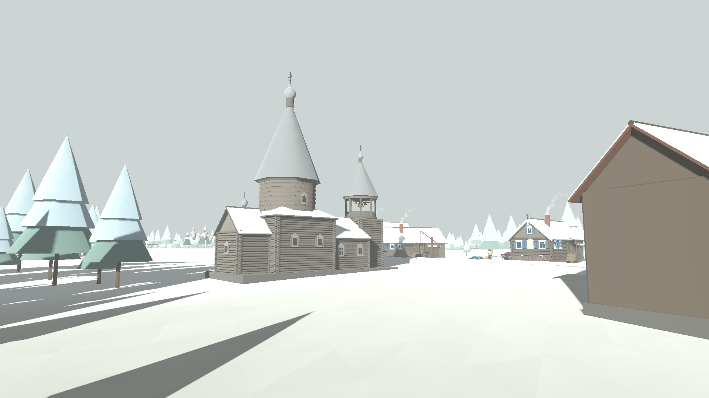
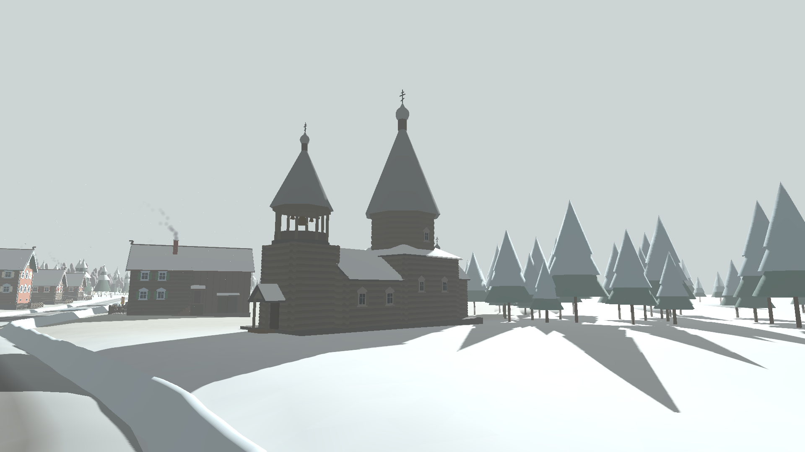
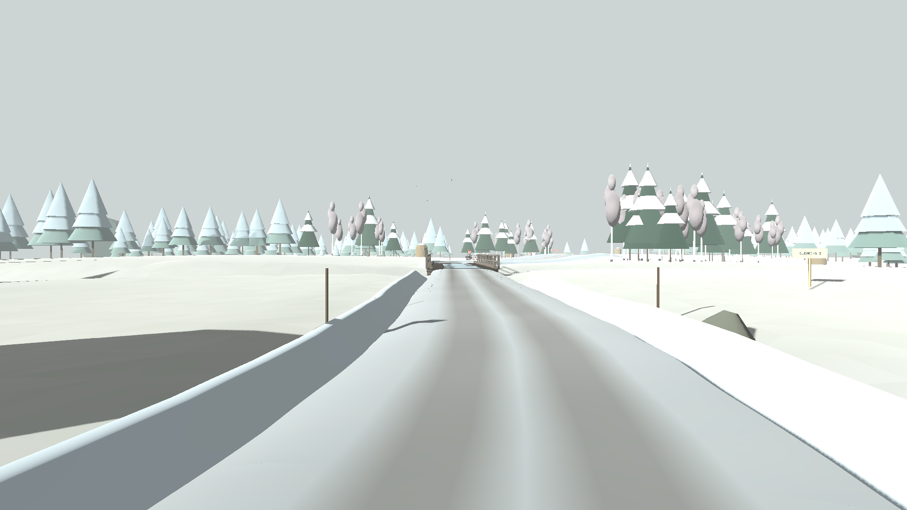

# Поречье

Седьмой СУ, `content_id: 6`, SKU `stage_07`. Зимний спецучасток на равнине
Русского Севера в духе деревень Вологодской и Архангельской областей:
открытые заснеженные поля с небольшим рельефом, укатанная снежная дорога с
настоящими поворотами и подбросами, деревня из рубленых изб, шатровая
церковь и бревенчатый мост через овраг с замёрзшим ручьём. Деревня и её
название — оригинальные, не копируют конкретное место; от региона взят
характер застройки. Масштаб такой же, как у остальных СУ: 840 маршрутных
единиц.



| Станции | Участок |
| --- | --- |
| 0–130 | Поле, быстрый левый поворот (R 42 м, ~92) и подброс на 132 |
| 145–240 | Правый поворот R 26 м (~160), затем левый R 40 м среди берёз |
| 250–330 | Подброс 1,9 м на 262 — самый высокий, вход в деревню |
| 330–560 | Деревня: 16 изб, колодец-журавль, объезд церковной площади (452 и 492), амбар на выезде |
| 576–630 | Сужение до 4,6 м, обледенелый бревенчатый мост через овраг (603–621) |
| 642 | Тугой правый R 24 м сразу после моста |
| 660–840 | Подбросы на 678 и 800, поворот R 32 м (716), быстрый финиш |

Перепад высот по всей трассе — около 4 м, это равнина. Высота подбросов
1,4–1,9 м: короткий подъём и крутой спуск, на скорости боевых экипажей машина
отрывается от дороги. Подбросы — горбы самой дороги, поля вокруг остаются
ровными.

## Маршрут

Геометрия — `game/scripts/stages/sever/sever.gd`. Курс задаётся списком
`CORNERS` (вершина, новый курс, радиус): прямые соединены дугами окружности,
затем снос по x убирается, чтобы финиш лежал в середине карты. `bends` —
вершины поворотов, `rally_speed` — по самому тугому повороту ближайших 30 м
и сцеплению на траектории, с ограничением в деревне и на мосту.

## Мост и овраг

Ручей течёт поперёк дороги по оврагу глубиной 2,4 м (`gully`, `meander`).
Дорога пересекает его по уровню: проезжая часть моста — это сама дорога, без
ступеньки на въезде, поэтому мост проезжаем на всей ширине. Под настилом
нарисованная земля прорезана (`terrain_vertex_height`), видно пролёт, ряжи и
ледяную ленту ручья. С моста не съехать в овраг: перила за краем проезжей
части — единственные твёрдые части моста. Отвалы снега на мосту убраны
(`snowbank_mask`, общий хук `stage_biome.gd`, по умолчанию 1).

## Покрытие

| Покрытие | Сцепление |
| --- | --- |
| Укатанный грунт (колея) | 0,64 |
| Укатанный снег | 0,42 |
| Лёд (мост и пять пятен) | 0,16 |

## Снег

Глубокий снег, отвалы, уплотнение, лопата, лагеря и синхронизация снега —
общие модули (`deep_snow.gd`, `snowbanks.gd`).

## Окружение

- `sever_carpentry.gd` — общая плотницкая геометрия: срубы с выпусками брёвен
  «в обло», тесовые двускатные крыши со снегом, фронтоны, причелины и
  полотенце, охлупень с коньком, окна с резными наличниками и ставнями.
- `sever_izba.gd` — изба-«кошель»: жилая часть на высоком подклете фронтоном
  к улице, крытый двор под той же крышей, светёлка, кирпичная труба,
  крыльцо со ступенями сбоку, ворота во двор, поленница. Часть фасадов
  обшита тёсом и покрашена.
- `sever_church.gd` — шатровая церковь «восьмерик на четверике»: алтарь,
  четверик с восьмериком и шатром, луковичная глава из осинового лемеха,
  трапезная и звонница с открытым восьмериком и колоколами на одной оси.
- `sever_bridge.gd` — мост: настил, колесоотбойные брёвна, перила, прогоны,
  ряжи у берегов и в русле, замёрзший ручей.
- `sever_scenery.gd` — сборка деревни: палисадники, колодец-журавль, амбар на
  камнях с галереей, стога на стожарах, вешки, берёзы и ели, дальняя тайга.
- `sever_life.gd` — снегопад, дым из труб, жители, собака, куры, вороны.







## Проверка

`game/tests/stages/test_sever.gd` (группа `world`): небольшой перепад высот,
подбросы, повороты и торможение перед ними, мост проезжаем по всей ширине без
ступенек, перила удерживают машину, под мостом открыт овраг; все постройки
стоят на земле и твёрдые, избы стоят в стороне от улицы; деревья не растут на
дороге, в деревне и в ручье; жители и дым; одинаковая генерация у клиентов.

Превью меню (`textures/previews/stage_6.webp`, `backdrop_6.webp`) и
скриншоты `docs/screenshots/sever-*.webp` снимает
`game/tools/screenshots/export_sever_screenshots.gd`:

```sh
xvfb-run -a godot --path game --rendering-method gl_compatibility --audio-driver Dummy --script res://tools/screenshots/export_sever_screenshots.gd
```
