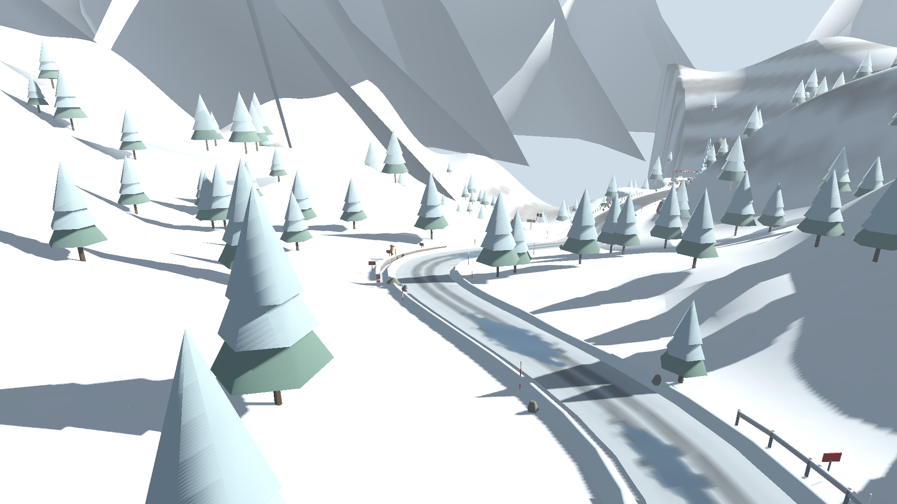
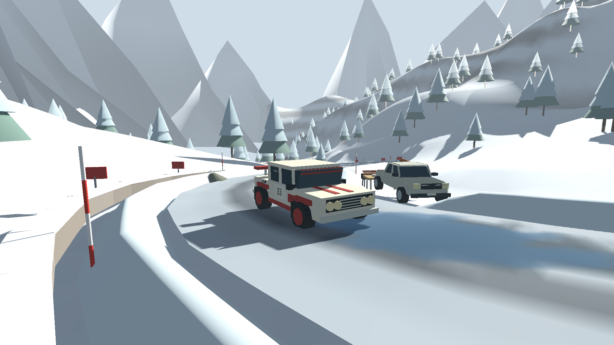
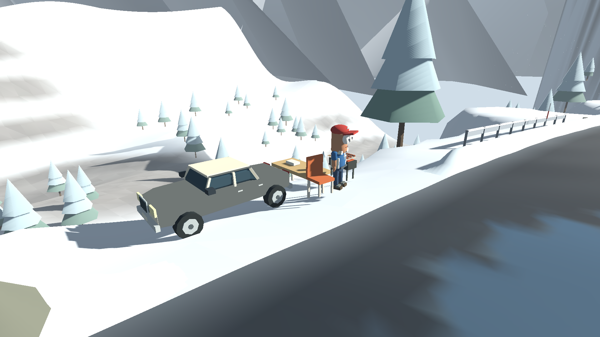
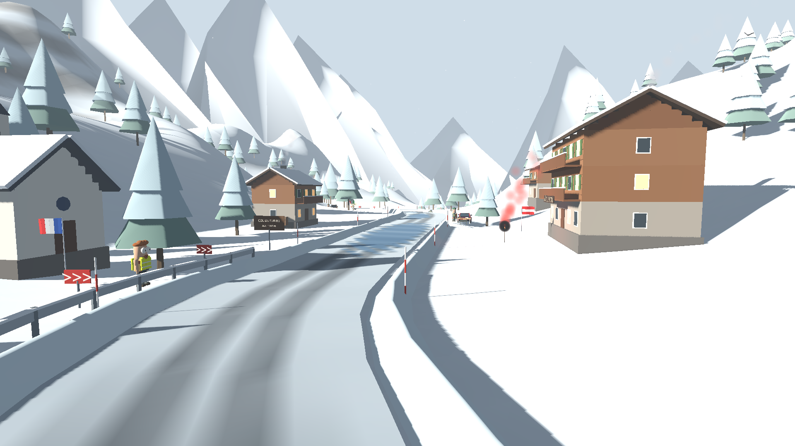
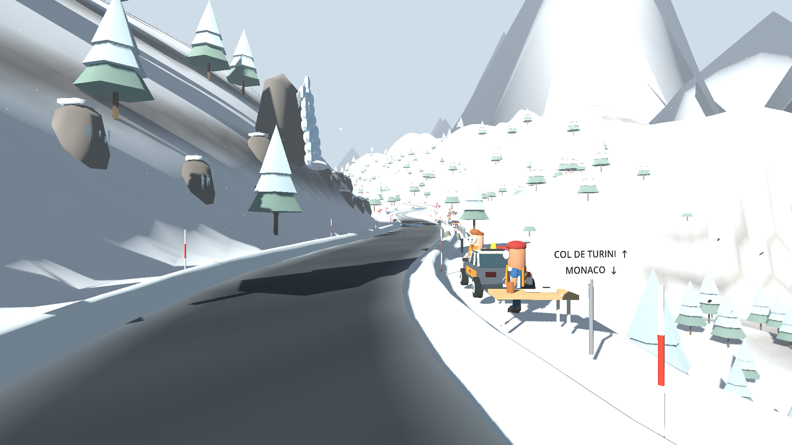
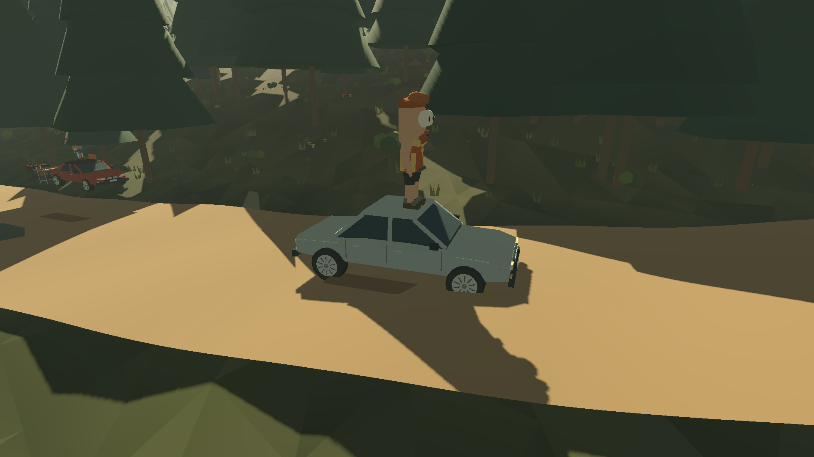
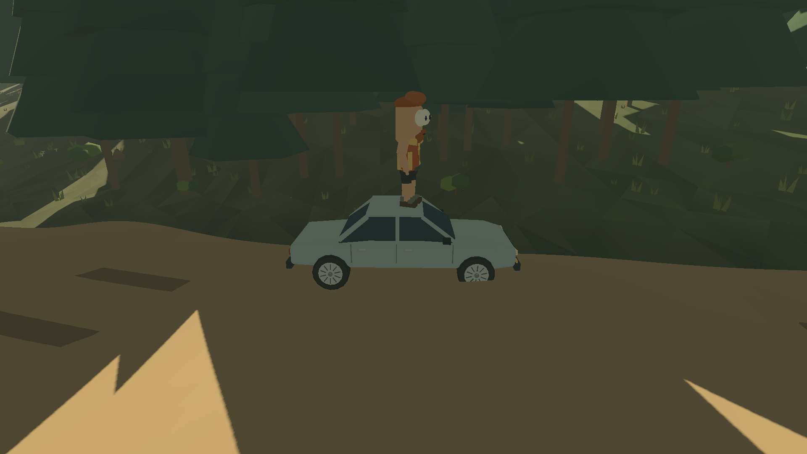
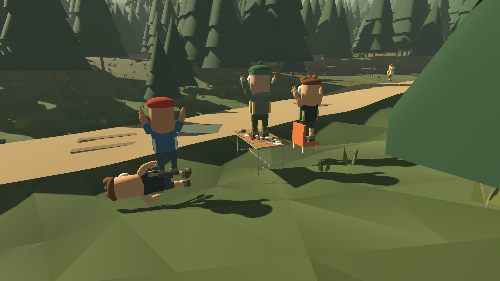

# Зимний Турини — игровые скриншоты

Снято из текущей игровой сцены Godot с её геометрией и освещением. Интерфейс скрыт; раллийная машина поставлена для кадра. Изображения не содержат рекламных наложений.











Все кадры — WebP, 1920 × 1080. Общий вид также используется в карточке зимнего СУ (480 × 240) и фоне меню (1280 × 720).

Для повторной съёмки из корня репозитория, с Godot 4.4.1 и доступным графическим дисплеем:

```sh
godot --path game --rendering-method gl_compatibility --audio-driver Dummy --script res://tools/screenshots/export_winter_screenshots.gd
```

На Linux без дисплея можно запустить эту команду через `xvfb-run -a` с программным OpenGL. Скрипт включает дальнюю прорисовку для съёмки, не меняя пользовательскую настройку.

# Запрыгнуть на машину, стол, стул, лежащего

Персонажа двигает сама игровая ходьба (`player_motion.gd` + `perches.gd`): прыжок на капот, второй прыжок на крышу, машина уезжает вместе с ним. Видимый человечек поставлен туда, где находится игрок (в игре своё тело от первого лица не рисуется).







Видео прыжков и поездки: [perch-car.mp4](perch-car.mp4).

```sh
xvfb-run -a godot --path game --rendering-method gl_compatibility --audio-driver Dummy --script res://tools/screenshots/export_perch_screenshots.gd -- /tmp/perch-frames
ffmpeg -framerate 30 -i /tmp/perch-frames/%04d.png -vf scale=960:-2 -c:v libx264 -pix_fmt yuv420p -crf 30 docs/screenshots/perch-car.mp4
```
